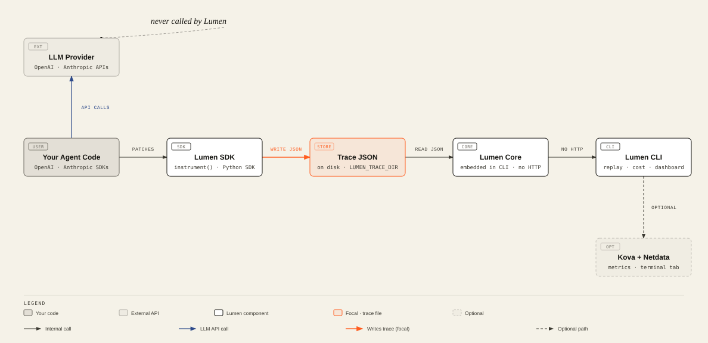

[中文](README.zh-CN.md) | English

# Lumen

**The black box for agent failures and spend** — open a run and see which step burned money,
which tool was refused, and how to continue after a crash.

Lumen is a two-part developer tool — a Python SDK you `instrument()` once, and a Rust CLI/dashboard
you point at the resulting trace files. LangGraph is the one fully supported integration today
(CrewAI/AutoGen are not built yet). Alpha (`Development Status :: 3 - Alpha`): core tracing, cost,
and replay are implemented and tested. The CLI ships as GitHub Release binaries; the Python SDK
installs from this repo until PyPI publish (do **not** `cargo install lumen-cli` — that crates.io
name is unrelated).

<picture>
  <source media="(prefers-color-scheme: dark)" srcset="docs/diagrams/architecture-dark.svg">
  
</picture>

## Core capabilities

- **One-line auto-instrumentation** — `instrument()` patches the OpenAI and Anthropic SDK clients and
  LangGraph so every call is traced without touching call sites (`lumen-sdk/lumen/instrument.py`).
- **Deterministic replay** — replay any past run from its trace JSON with zero LLM calls, optionally
  starting mid-run with `--from-step` (`lumen-core/src/replay.rs`, `lumen-sdk/lumen/replay.py`).
- **Cost tracking and pricing** — per-agent, per-model USD breakdown from token counts, covering 30+
  models, with per-run cost-outlier flagging (`lumen-core/src/cost.rs`, `lumen-core/src/pricing.rs`,
  `lumen-sdk/lumen/cost.py`, `lumen-sdk/lumen/pricing.py`).
- **Crash-safe checkpointing** — a `LumenCheckpointer` for LangGraph that persists to disk with no
  external services, so a crashed process resumes from its last checkpoint
  (`lumen-sdk/lumen/integrations/langgraph.py`).
- **Budget guard and anomaly detection** — kill-on-exceeded budget tracking and cost/metric anomaly
  detection with a configurable multiplier (`lumen-sdk/lumen/_budget.py`, `lumen-sdk/lumen/_anomaly.py`).
- **Web dashboard** — a trace timeline plus, when pointed at a live Kova + Netdata, a live Metrics tab
  (Prometheus metrics with per-metric ML anomaly ribbons) and a Terminal tab (whitelisted Kova control
  console, not a real shell) (`lumen-cli/src/dashboard.rs`, `lumen-cli/src/netdata.rs`, `lumen-cli/src/kova.rs`).

## Quick start

**1. Install the CLI** (no Rust required):

```bash
curl -fsSL https://raw.githubusercontent.com/hanmahong5-arch/lumen/main/docs/install-cli.sh | bash
export PATH="$HOME/.local/bin:$PATH"
lumen --version   # -> lumen 0.3.0
```

**2. See a lifecycle in one command** (offline sample — no Kova, no API key):

```bash
lumen demo
# writes lumen-demo-lifecycle.html and opens it
```

**3. Trace your own agent** (Python 3.10+):

```bash
git clone https://github.com/hanmahong5-arch/lumen.git && cd lumen
pip install -e "./lumen-sdk[langgraph]"
```

```python
from lumen import instrument, trace

instrument()  # auto-detect OpenAI / Anthropic / LangGraph; all later calls recorded

with trace("research-task") as t:
    r1 = client.chat.completions.create(model="your-model", messages=[...])
    print(f"Trace: {t.trace_id}, cost: ${t.total_cost_usd:.4f}")
```

Have a live Kova? `lumen demo --live` (or `--kova-url`) runs a real agent instead of the sample.
Full install options (Windows binary, source build): [docs/INSTALL.md](docs/INSTALL.md).

## Architecture

```
lumen-core/   Rust engine (embedded in the CLI, no HTTP): trace types, replay, cost
              aggregation, pricing tables, lifecycle assembly for the dashboard/export.
              Vendors kova-types' trace format locally so the crate builds standalone
              (lumen-core/Cargo.toml:9-11).
lumen-cli/    Rust CLI + web dashboard: subcommands (main.rs), dashboard server
              (dashboard.rs/.html), Kova control-console interpreter (kova.rs),
              Netdata metrics proxy (netdata.rs), trace puller (pull.rs), demo
              orchestration (demo.rs).
lumen-sdk/    Python package `lumen-ai`: instrument() auto-instrumentation, trace
              writers/readers, cost/pricing, budget + anomaly detection, redaction,
              hierarchical config (config.py), and integrations/ (OpenAI, Anthropic,
              LangGraph tracer + checkpointer).
```

Data flow: your Python code → **Lumen SDK** writes trace JSON to disk →
**Lumen Core** (embedded in the CLI) reads that JSON for replay/cost/lifecycle rendering → your LLM
provider is only ever called by your own code, never by Lumen.

## Configuration

SDK config resolves in order: hardcoded defaults → `~/.lumen/config.toml` → `./lumen.toml` (walked up
from cwd) → `LUMEN_*` environment variables → explicit builder overrides (`lumen-sdk/lumen/config.py:1-9`).

| Variable | Default | Description |
|---|---|---|
| `LUMEN_ENABLED` | `true` | Master switch for trace capture (`config.py:351`) |
| `LUMEN_TRACE_DIR` | `./traces` | Where trace JSON is written/read (`config.py:352`) |
| `LUMEN_SAMPLING_RATE` | `1.0` | Fraction of calls traced (`config.py:353`) |
| `LUMEN_BUDGET_USD` | `0.0` | Budget ceiling; `0` = unlimited (`config.py:357`) |
| `LUMEN_KILL_ON_BUDGET` | `false` | Raise/kill when the budget is exceeded (`config.py:358`) |
| `LUMEN_ANOMALY_MULTIPLIER` | `2.0` | Cost-outlier threshold: > N × the run mean (`config.py:359`) |
| `LUMEN_REDACTION_ENABLED` | `false` | Redact matched patterns before writing traces (`config.py:355`) |
| `LUMEN_NETDATA_URL` | — | Dashboard Metrics tab source, e.g. `http://localhost:19999` (`main.rs:333`) |
| `LUMEN_KOVA_URL` | — | Kova base URL for `pull`/`export`/`kova`/Terminal tab (`main.rs:350`) |
| `LUMEN_KOVA_API_KEY` / `KOVA_API_KEY` | — | Kova `X-API-Key`, held server-side, never sent to the browser (`main.rs:341-342`) |
| `KOVA_LLM_API_KEY` | — | Required by `lumen demo`'s agent loop (`demo.rs:109`) |
| `KOVA_REST_BIN` | — | Path to the `kova-rest` binary for `lumen demo`'s ephemeral path (`demo.rs:143`) |

## CLI overview

```
lumen replay <trace-id> [--from-step N]                 # replay a run, zero LLM cost
lumen cost --last 24h [--format json]                    # cost report + per-run outliers
lumen traces [--trace-dir ./traces]                       # list agent runs
lumen dashboard [--netdata-url …] [--kova-url … --api-key …]  # web UI
lumen metrics --last 10m [--format json]                  # headless Netdata snapshot
lumen pull --kova-url <url> [--deep]                       # fetch traces from a live Kova
lumen export <run> [--trace-dir …] [--kova-url …]          # one run -> self-contained .html
lumen kova "<verb>" [--kova-url …] [--yes]                 # one-shot Kova control command
lumen demo [--kova-url …] [--kova-bin …]                   # zero-setup: run + visualize
lumen tour                                                  # assemble a multi-run index.html
```

`lumen kova`/the dashboard's Terminal tab speak a whitelisted verb set against Kova's REST API — read
verbs (`status`, `agents`, `workflows`, `schedules`, `tools`, `queues`, `traces`, `llm`, …), safe
mutations (`agent <id> run|stop|pause|resume|restart|approve|deny`, `workflow <id> cancel|resume`,
`schedule <id> pause|resume`), and destructive verbs that require `--yes` or a second confirmation
(`agent <id> reset|terminate|delete`, `schedule <id> delete`, `trace <id> delete`) — see
`lumen-cli/src/kova.rs`. It is a REST interpreter, not a shell: no raw `std::process` exec and no
arbitrary path/method/host.

## Development

- Rust workspace lints deny `unwrap()`/`expect()`/`panic!()` and unsafe-in-unsafe-fn
  (`Cargo.toml:11-17`); CI (`.github/workflows/release-lumen-cli.yaml`) gates every tagged build on
  `cargo test`, `cargo clippy -- -D warnings`, and `cargo fmt --check`.
- `lumen-core`'s trace types are a local vendor copy of `kova-types` (kept in sync by hand, see the
  comment in `lumen-core/Cargo.toml`) so this repo builds standalone with no private sibling dependency.
- Release tags: a plain `vX.Y.Z` push fires both `publish-lumen-sdk.yaml` and `release-lumen-cli.yaml`;
  per-artifact `lumen-sdk-vX.Y.Z` / `lumen-cli-vX.Y.Z` tags ship one side only.
- Repo-local development conventions (brand boundary, directory layout, command cheatsheet) live in this
  repo's own dev-convention doc, which is intentionally excluded from the public tree (see `.gitignore`).

## Related projects

Lumen is the open, independent-branded observability client for **Kova** (`2b-svc-kova`), a Lurus agent
runtime — `lumen-cli` talks to Kova's REST API (`pull`, `export --kova-url`, `kova`, Terminal tab) and
`lumen-core` vendors Kova's trace schema, but end users of Lumen never need to know Kova exists. The
dashboard's lifecycle rendering (`lumen-cli/src/dashboard.rs`, `lumen-core/src/flow_types.rs`) shares its
data model with **Forge** (`2b-bs-forge`), which embeds Lumen for its own lifecycle-export feature.

## License and third-party notices

MIT — see [LICENSE](LICENSE). Third-party Rust crate licenses for the compiled `lumen` binary are listed
in [THIRD-PARTY-NOTICES.md](THIRD-PARTY-NOTICES.md) (generated with `cargo about generate`); no upstream
project is forked or vendored beyond the `kova-types` trace-schema copy noted above.
